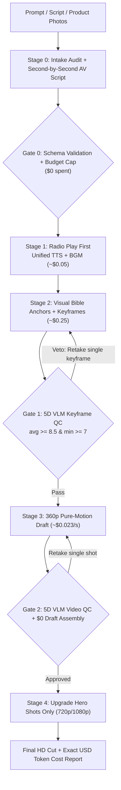

# AI Video Director (`ai-video-director`)

**English** | [简体中文](README_CN.md)

An industrial, low-cost, quality-gated AI video production framework and Agent Skill for **9:16 vertical commercials** and **16:9 horizontal explainers/coaching videos**.

Stop treating AI video generation like an expensive slot machine. **AI Video Director** decouples planning, audio, visual anchors, motion generation, quality control, and final composition—cutting 60-second production costs by **65%–85%** while enforcing strict physics, anatomy, and product fidelity.

---

## Why This Workflow?

Most end-to-end AI video wrappers burn $4–$10+ per 60-second video because they ask a single video model to act, speak narration, render readable text, and keep characters/products consistent all at once. One small flaw forces a full-clip re-roll.

**AI Video Director** applies four battle-tested production principles (inspired by *OpenMontage*, *HKUDS/ViMax*, *VBench-2.0 / VideoScore2*, and commercial *AV Script* workflows):

1. **Plan & Gate Before Spending (`Stage 0`)**: Strict JSON Schema validation (`--stage validate`) rejects vague one-line prompts. Every shot requires second-by-second `beat_timeline`, `camera`, `physics_and_fidelity_constraints`, `tier`, and a hard `max_budget_usd` circuit breaker.
2. **Radio Play First (`Stage 1`)**: Lock unified TTS voiceover (`gemini-3.8-flash-tts`) and mood-matched BGM (`lyria-3.5`) first (~$0.02–$0.07) so audio timing dictates exact cuts.
3. **Draft-First → Hero-Upgrade (`Stages 2–4`)**: Lock character/product anchors and keyframes → pass a **5-Dimension CoT VLM Quality Gate** (`>= 8.5` avg & no dimension `< 7`) → preview the full 60s cut at **`360p` (~$0.023/sec, 1/3 the cost of 720p)** → upgrade **only `tier: "hero"` shots** to `720p`/`1080p` with one command.
4. **$0 Local Composition (`Stage 5`)**: Crisp subtitles, slow-motion, freeze-frame vector callouts (circles/lines/waterline guides), chapter progress bars, audio ducking, and brand endcards are rendered locally with Pillow + FFmpeg. Re-editing copy, timing, or overlays costs **$0**.

---

## Architecture Overview



---

## Measured Cost Comparison (60s Video)

| Approach | 60s Video API Spend | Re-edit Copy / Subtitles / Callouts |
| :--- | :--- | :--- |
| End-to-end 720p generation (4×14s + 1 retake) | ~$8.30+ | Must regenerate video ($1–$4) |
| **AI Video Director (`360p` full draft)** | **~$0.95 – $1.35** | **$0.00** (15s local re-render) |
| **AI Video Director (`360p` + 4 Hero shots @ `720p`)** | **~$2.60 – $2.95** | **$0.00** (15s local re-render) |

---

## Prerequisites

- **Python 3.10+** & Pillow (`pip install -r requirements.txt`)
- **FFmpeg & FFprobe** available on `PATH`
- **[`gemini-api` CLI](https://github.com/google-gemini/gemini-api-cli)** installed on `PATH` with `GEMINI_API_KEY` set (Paid Tier enabled for video generation)

---

## Quick Start

```bash
# 1. Install Python dependency
pip install -r requirements.txt

# 2. Validate storyboard schema ($0)
python video_flow.py --config examples/product_ad_9x16.json --stage validate

# 3. Run full 360p low-cost draft pre-viz (audio -> assets -> keyframes -> Gate 1 -> 360p video -> Gate 2 -> assemble -> cost)
# Optional: swap voiceover engine via --tts-provider {edge,elevenlabs,gemini,openai,local} (edge is $0 free!)
python video_flow.py --config examples/product_ad_9x16.json --stage all --res 360p --tag draft_360p

# 4. After reviewing the draft, upgrade ONLY tier="hero" shots to 720p and re-assemble
python video_flow.py --config examples/product_ad_9x16.json --stage upgrade_hero --res 720p --tag final_hd

# 4b. Or upgrade hero shots on Google Cloud Vertex AI (defaults to Veo 3.1 Lite @ $0.05/s; override per-shot with vertex_video_model="veo-3.1-fast-generate-001")
# Tip: set "motion": "static_ken_burns" (or "static_zoom_out") on product/outro shots for $0 local HD smooth push-in/pull-out
# Requires: pip install google-genai, GOOGLE_CLOUD_PROJECT, and GOOGLE_APPLICATION_CREDENTIALS (Service Account JSON)
python video_flow.py --config examples/product_ad_9x16.json --stage upgrade_hero --backend vertex --res 720p --tag final_hd_veo

# 5. Zero-cost re-render after tweaking subtitles, callouts, tempo, or endcard
python video_flow.py --config examples/product_ad_9x16.json --stage assemble --tag final_v2

# 6. Check exact token-based USD cost breakdown
python video_flow.py --config examples/product_ad_9x16.json --stage cost
```

---

## Using the Included Agent Skill

This repo ships with a ready-to-use Agent Skill in `skills/video-production-director/` compatible with **Antigravity**, **Claude Code**, **Cursor**, and any `SKILL.md`-aware coding agent.

Copy `skills/video-production-director/` into your agent's skills directory (e.g. `~/.claude/skills/` or your Antigravity plugin's `skills/` folder). Whenever you ask your agent to make a video, it will automatically:
1. Run the **8-point Stage 0 Intake Audit** (refusing to guess or burn credits on vague prompts);
2. Research domain physics / product details first;
3. Draft a **Visual Bible + Second-by-Second AV Script + Budget Estimate** for your sign-off;
4. Execute the gated `360p → hero 720p/1080p` pipeline via `video_flow.py`.

---

## Repository Structure

```text
ai-video-director/
├── video_flow.py                         # Core cross-platform pipeline engine
├── requirements.txt                      # Minimal dependency (Pillow)
├── docs/
│   └── architecture.md                   # Full 6-role & 4-gate architecture blueprint
├── examples/
│   ├── product_ad_9x16.json              # 9:16 vertical wellness product commercial example
│   └── freestyle_coaching_16x9.json      # 16:9 horizontal sports coaching example (with freeze-frame vector callouts)
└── skills/
    └── video-production-director/
        ├── SKILL.md                      # Agent skill instructions
        └── references/
            └── av-script-template.md     # Gate 0 second-by-second AV script template
```

## License

[MIT](LICENSE)
