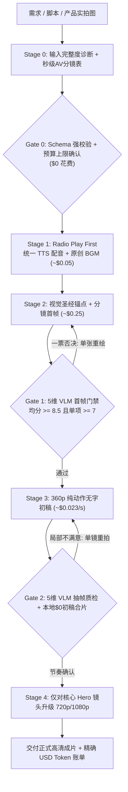

# AI Video Director (`ai-video-director`)

[English](README.md) | **简体中文**

一套工业级、低成本、强质量门禁的 AI 视频制片框架与 Agent Skill，原生支持 **9:16 竖屏商业广告** 与 **16:9 横屏科普/教学视频**。

告别把 AI 视频当成昂贵“老虎机”盲抽的做法。**AI Video Director** 将前置策划、配音配乐、视觉资产锚点、纯动作视频生成、VLM 质检门禁与本地剪辑合成彻底解耦——将单条 60 秒视频成本降低 **65%–85%**，同时严格把控物理规律、人体解剖动作与实物产品 1:1 还原度。

---

## 为什么需要这套工作流？

市面上绝大多数端到端 AI 视频工具，生成一条 60 秒视频动辄消耗 $4–$10+，原因在于让同一个昂贵视频模型同时干“演动作 + 念旁白 + 写文字 + 保持人物和产品一致”四件事；只要有一处动作畸变或错字，整段重抽就是翻倍烧钱。

**AI Video Director** 融合了 4 项经过实战验证的工程与影视工业原则（参考 *OpenMontage*、*HKUDS/ViMax*、*VBench-2.0 / VideoScore2* 与商业广告 *AV Script* 规范）：

1. **先规划、先控质、后花钱（`Stage 0`）**：通过强 Schema 校验（`--stage validate`）拒绝一句话模糊盲拍。每个镜头必须显式定义秒级 `beat_timeline`、`camera`、`physics_and_fidelity_constraints`、`tier` 以及硬性预算熔断上限 `max_budget_usd`。
2. **音频先行定骨（Radio Play First，`Stage 1`）**：先用 `gemini-3.8-flash-tts` 与 `lyria-3.5` 锁定统一声线旁白与情绪配乐（仅约 $0.02–$0.07），让精确到 0.1 秒的音频节奏反推每个镜头的剪辑卡点。
3. **低成本 360p 预演 → 仅升级核心镜头（`Stages 2–4`）**：先锁人物与 1:1 产品锚点图并生成分镜首帧 → 通过 **5 维 CoT VLM 质检门禁**（均分 `>= 8.5` 且无单项 `< 7`，不通过一票否决）→ 全片先用 **`360p` 预演（约 $0.023/秒，仅为 720p 的 1/3）** → 审定节奏后，一键只把 `tier: "hero"` 的核心镜头升级为 `720p`/`1080p`。
4. **本地 $0 精剪与改稿（`Stage 5`）**：锐利中文字幕、慢放、关键瞬间定格矢量标注（圆圈/箭头/水平基准线）、章节进度条、BGM 闪避混音与结尾产品定格卡全部由本机 Pillow + FFmpeg 完成。改文案、换字效、调语速或微调标注位置均为 **$0 成本**。

---

## 整体架构



---

## 实测成本对比（60 秒成片）

| 方案 | 60 秒视频 API 花费 | 后期改文案 / 改字幕 / 改标注 |
| :--- | :--- | :--- |
| 传统端到端 720p 硬生（4×14s + 1 轮返工） | ~$8.30+ | 必须重烧视频（$1–$4） |
| **AI Video Director（全片 `360p` 完整初稿）** | **~$0.95 – $1.35** | **$0.00**（本机 15 秒重渲） |
| **AI Video Director（`360p` + 4 个核心 Hero 镜升 `720p`）** | **~$2.60 – $2.95** | **$0.00**（本机 15 秒重渲） |

---

## 环境要求

- **Python 3.10+** 与 Pillow（`pip install -r requirements.txt`）
- 系统 `PATH` 中已安装 **FFmpeg & FFprobe**
- 系统 `PATH` 中已安装 **[`gemini-api` CLI](https://github.com/google-gemini/gemini-api-cli)** 并配置 `GEMINI_API_KEY`（视频生成需开通 Paid Tier）

---

## 快速开始

```bash
# 1. 安装 Python 依赖
pip install -r requirements.txt

# 2. 强 Schema 校验（$0，拒绝一句话模糊配置）
python video_flow.py --config examples/product_ad_9x16.json --stage validate

# 3. 一键跑 360p 低成本完整初稿（音频 -> 资产 -> 首帧 -> Gate 1 -> 360p视频 -> Gate 2 -> 合成 -> 账单）
# 可选：通过 --tts-provider {edge,elevenlabs,gemini,openai,local} 自由切换配音引擎（edge 完全 $0 免费，elevenlabs 影视级音色）
python video_flow.py --config examples/product_ad_9x16.json --stage all --res 360p --tag draft_360p

# 4. 初稿审定后，一键只把 tier="hero" 的核心镜头升级为 720p 并自动重渲终片
python video_flow.py --config examples/product_ad_9x16.json --stage upgrade_hero --res 720p --tag final_hd

# 4b. 或切换至 Google Cloud Vertex AI（默认 Veo 3.1 Lite @ $0.05/秒，单镜可按需指定 veo-3.1-fast-generate-001，可直接抵扣 GCP $300 赠金）
# 省钱技巧：产品特写/结尾静帧可加 "motion": "static_ken_burns"（或 "static_zoom_out"），本机 FFmpeg $0 渲染高清平滑推拉
# 需配置：pip install google-genai、GOOGLE_CLOUD_PROJECT 与 GOOGLE_APPLICATION_CREDENTIALS（服务账号 JSON）
python video_flow.py --config examples/product_ad_9x16.json --stage upgrade_hero --backend vertex --res 720p --tag final_hd_veo

# 5. 调整字幕、标语位置、语速或结尾定格卡后，本机 $0 秒速重渲
python video_flow.py --config examples/product_ad_9x16.json --stage assemble --tag final_v2

# 6. 查看基于真实 Token 用量的精确美元账单
python video_flow.py --config examples/product_ad_9x16.json --stage cost
```

---

## 多引擎分工决策矩阵（Stage 0 自动路由）

在 Stage 0 写分镜表时，按镜头类型自动分配最优生成引擎，只把预算花在不可替代的镜头上：

| 镜头 / 内容类型 | 推荐生成引擎 | 单镜成本 |
| :--- | :--- | :--- |
| 3D 产品拆解、数据/地图科普、艺术风格动画概念片 | 纯代码映画（`lemo-opuscar` / Three.js / Canvas，99 种风格） | **\$0** |
| 静态产品微距展示、品牌定格、静谧空镜 | 高清首帧 + 本机 `static_ken_burns` 平滑推拉 | 约 **\$0.036**（仅出图费） |
| 常规真人生活镜、柔和环境动态 | Vertex AI `veo-3.1-lite-generate-001`（4s @ 720p） | **\$0.20/镜** |
| 复杂人物情绪表演、人与产品物理交互 Hero 镜 | Vertex AI `veo-3.1-fast-generate-001` 或 AI Studio `360p→720p` | **\$0.40–\$0.60/镜** |
| 全片高级包装（弹性胶囊、液态玻璃、实时仪表盘、逐字高亮字幕、音效、结尾卡） | 本机 `Remotion` + `video-effects`（1080p 矢量渲染） | **\$0** |

---

## 使用内置 Agent Skill（AI 编程助手自动接入）

本仓库在 `skills/video-production-director/` 中附带了开箱即用的标准 Agent Skill，兼容 **Antigravity**、**Claude Code**、**Cursor** 等支持 `SKILL.md` 的 AI 助手。

将该目录复制到你的 Agent Skills 路径（例如 `~/.claude/skills/` 或 Antigravity 插件的 `skills/` 目录）后，每次让 AI 做视频时都会自动执行：
1. **Stage 0 八项输入完整度诊断**（输入不完整时拒绝盲猜烧钱，主动追问或起草完整方案）；
2. **领域物理 / 产品外观前置调研**，编写硬性约束与负面避坑清单；
3. 输出 **《视觉圣经 + 秒级 AV 分镜表 + 成本预算》**，获你批准（Gate 0）后才开拍；
4. 自动通过 `video_flow.py` 走完 `360p 初稿 → 5 维质检 → Hero 高清升级` 全流程。

---

## 仓库目录结构

```text
ai-video-director/
├── README.md                             # 英文说明文档
├── README_CN.md                          # 中文说明文档
├── video_flow.py                         # 跨平台核心视频生产引擎
├── requirements.txt                      # 最小依赖（Pillow）
├── docs/
│   └── architecture.md                   # 6 角色分工与 4 道门禁完整架构文档
├── examples/
│   ├── product_ad_9x16.json              # 9:16 竖屏健康产品科普广告范例
│   └── freestyle_coaching_16x9.json      # 16:9 横屏自由泳教学范例（含定格矢量标注）
└── skills/
    └── video-production-director/
        ├── SKILL.md                      # Agent Skill 指令文件
        └── references/
            └── av-script-template.md     # Gate 0 秒级 AV 分镜送审模板
```

## 开源协议

[MIT](LICENSE)
